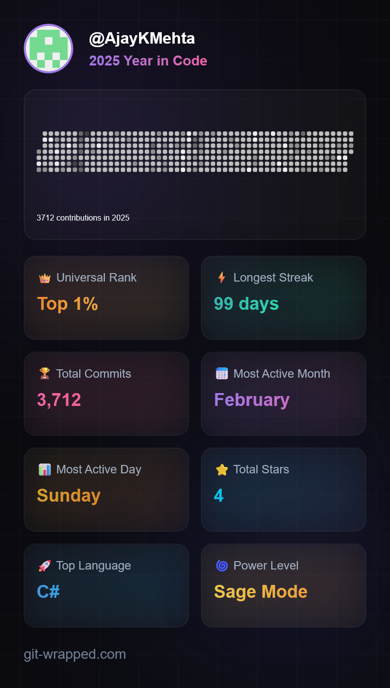
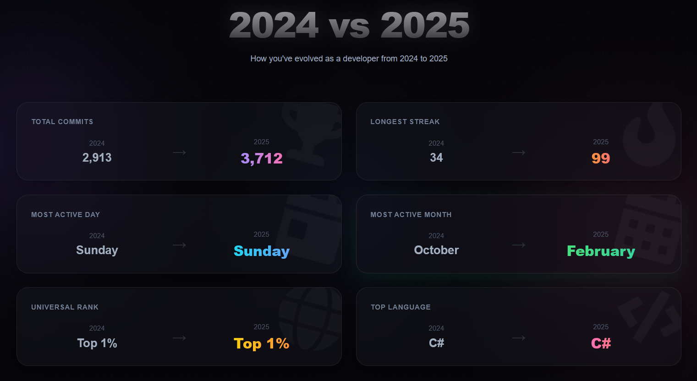

:construction: **WORK IN PROGRESS** :construction:

**Hi there 👋, I'm Ajay.**

## Stats

<picture>
  <source
    srcset="https://github.com/AjayKMehta/AjayKMehta/blob/master/img/stats-dark.svg"
    media="(prefers-color-scheme: dark)"
  />
  <source
    srcset="https://github.com/AjayKMehta/AjayKMehta/blob/master/img/stats-default.svg"
    media="(prefers-color-scheme: light), (prefers-color-scheme: no-preference)"
  />
  
</picture>

### 2025

## Skills and interests

### Languages

    
    <!---->

### :cloud:

### Data

### Other

## Recent activity

<!--START_SECTION:activity-->
1. 🚀 Committed to main in [AjayKMehta/setup-machine](https://github.com/AjayKMehta/setup-machine/commit/0fcc695b3e4636135fc1a658c86dcdda1e6e227d)
2. 🚀 Committed to main in [AjayKMehta/WSL](https://github.com/AjayKMehta/WSL/commit/51724c9ee52ca05fbc0eb9ee774ad5974fbf9d04)
3. 🚀 Committed to main in [AjayKMehta/WSL](https://github.com/AjayKMehta/WSL/commit/1c2942c9d48603abcde51547fae8019fbe2682c7)
4. 🚀 Committed to main in [AjayKMehta/setup-machine](https://github.com/AjayKMehta/setup-machine/commit/5f2ce15a6927545bf4bd0ad83ebe2e061a7db635)
5. 🚀 Committed to main in [AjayKMehta/WSL](https://github.com/AjayKMehta/WSL/commit/10239d5bd7224179378eda01537940e05b3e8aba)
6. 🚀 Committed to main in [AjayKMehta/WSL](https://github.com/AjayKMehta/WSL/commit/400e43c0e36f8c415825445dc1476064d773381e)
7. 🚀 Committed to main in [AjayKMehta/WSL](https://github.com/AjayKMehta/WSL/commit/4db856cfea67909037cd8b25668f9a3bcdfc88d7)
8. 🚀 Committed to master in [AjayKMehta/Dappery](https://github.com/AjayKMehta/Dappery/commit/ddebe106464a5a50f2922b050040718da0ced7bc)
9. 🚀 Committed to main in [AjayKMehta/setup-machine](https://github.com/AjayKMehta/setup-machine/commit/f4f8ca94efceed10123527ee2b31ea4f6d146c31)
10. 🚀 Committed to main in [AjayKMehta/setup-machine](https://github.com/AjayKMehta/setup-machine/commit/2f05d86f3d5825de99bbe7835c6552445a295e49)
11. 🚀 Committed to main in [AjayKMehta/setup-machine](https://github.com/AjayKMehta/setup-machine/commit/b32efb4c5bac435b0a82833cb487e9f0e7453ea2)
12. 🚀 Committed to main in [AjayKMehta/dotfiles](https://github.com/AjayKMehta/dotfiles/commit/10579fff71b666dbe3e60ba2283bc7d3d94470cc)
13. 🚀 Committed to main in [AjayKMehta/setup-machine](https://github.com/AjayKMehta/setup-machine/commit/0c88a14f7d20f7c807b38c3f4be8483445e26564)
14. 🚀 Committed to main in [AjayKMehta/dotfiles](https://github.com/AjayKMehta/dotfiles/commit/c8bd7584c2c6070ca5f3268de5bbd54b4c2c1776)
15. 🚀 Committed to main in [AjayKMehta/dotfiles](https://github.com/AjayKMehta/dotfiles/commit/2e39e3dc6dde6bc97ec5cc769b025db0cd205e2c)
<!--END_SECTION:activity-->

> [!NOTE]
> This includes activity for public repos *only*.
