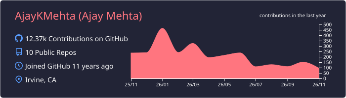
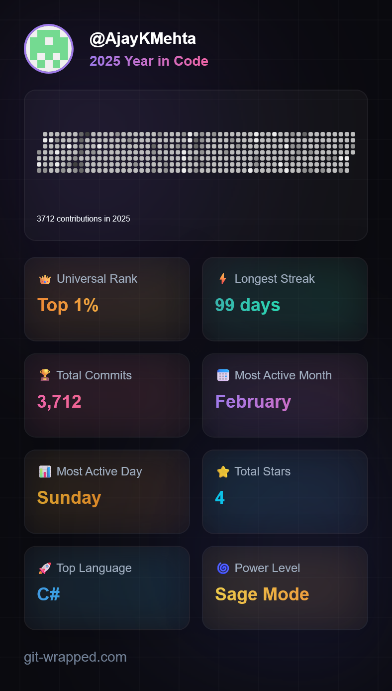
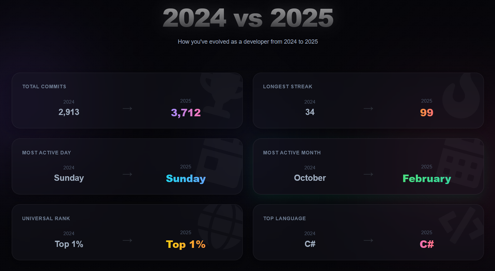
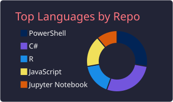
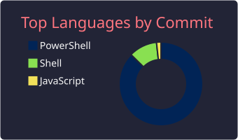

:construction: **WORK IN PROGRESS** :construction:

**Hi there 👋, I'm Ajay.**

## Stats

<picture>
  <source
    srcset="https://github.com/AjayKMehta/AjayKMehta/blob/master/img/stats-dark.svg"
    media="(prefers-color-scheme: dark)"
  />
  <source
    srcset="https://github.com/AjayKMehta/AjayKMehta/blob/master/img/stats-default.svg"
    media="(prefers-color-scheme: light), (prefers-color-scheme: no-preference)"
  />
  
</picture>

### 2025

## Skills and interests

### Languages

    
    <!---->

### :cloud:

### Data

### Other

## Recent activity

<!--START_SECTION:activity-->
1. 🚀 Committed to main in [AjayKMehta/WSL](https://github.com/AjayKMehta/WSL/commit/676f795dd5949953f827e026b400fa390021df3d)
2. 🚀 Committed to master in [AjayKMehta/builderbuilder](https://github.com/AjayKMehta/builderbuilder/commit/f798909f7e82c2a452f320aff0dbe9b120e4a79d)
3. 🚀 Committed to main in [AjayKMehta/setup-machine](https://github.com/AjayKMehta/setup-machine/commit/ea70848f34586576cddbb557c671ec63fa2fe595)
4. 🚀 Committed to main in [AjayKMehta/quarto-template](https://github.com/AjayKMehta/quarto-template/commit/ae12a4d9520e8b85a96933a4b7b44992dd004eea)
5. 🚀 Committed to main in [AjayKMehta/template-dotnet](https://github.com/AjayKMehta/template-dotnet/commit/8e709a8ee43cb11a3e938417e9f6f027a37024fc)
6. 🚀 Committed to main in [AjayKMehta/quarto-blog](https://github.com/AjayKMehta/quarto-blog/commit/fb396673617579106cc98780e78499bcdc443ff3)
7. 🚀 Committed to master in [AjayKMehta/PowerShellScripts](https://github.com/AjayKMehta/PowerShellScripts/commit/df281d28e33240fb8bf8eab53f1b3d37570cfe60)
8. 🚀 Committed to master in [AjayKMehta/Dappery](https://github.com/AjayKMehta/Dappery/commit/fac15cdab7bf868de912e545ca60ab2db970302a)
9. 🚀 Committed to master in [AjayKMehta/builderbuilder](https://github.com/AjayKMehta/builderbuilder/commit/dd0f574626aa67e232fca586d7a812bad15acf60)
10. 🔎 Created PR #5 in [AjayKMehta/PowerShellScripts](https://github.com/AjayKMehta/PowerShellScripts/pull/5#pullrequestreview-5729946438)
11. 🔎 Created PR #532 in [AjayKMehta/Dappery](https://github.com/AjayKMehta/Dappery/pull/532#pullrequestreview-5728954669)
12. 🚀 Committed to master in [AjayKMehta/builderbuilder](https://github.com/AjayKMehta/builderbuilder/commit/1c165499ed23a13f509d2e33e49a6c8c0d60579f)
13. 🚀 Committed to master in [AjayKMehta/Dappery](https://github.com/AjayKMehta/Dappery/commit/25743f83c5ee30321c1ae3485e8283a78c4803d6)
14. 🚀 Committed to main in [AjayKMehta/setup-machine](https://github.com/AjayKMehta/setup-machine/commit/0fcc695b3e4636135fc1a658c86dcdda1e6e227d)
15. 🚀 Committed to main in [AjayKMehta/WSL](https://github.com/AjayKMehta/WSL/commit/51724c9ee52ca05fbc0eb9ee774ad5974fbf9d04)
<!--END_SECTION:activity-->

> [!NOTE]
> This includes activity for public repos *only*.
