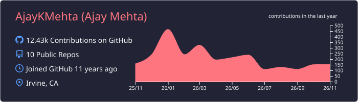
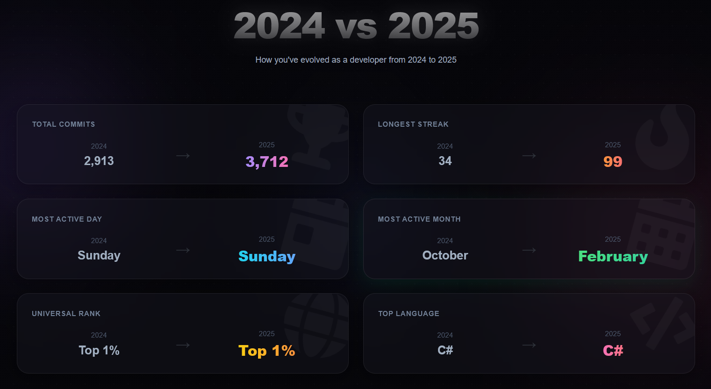
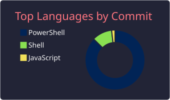

:construction: **WORK IN PROGRESS** :construction:

**Hi there 👋, I'm Ajay.**

## Stats

<picture>
  <source
    srcset="https://github.com/AjayKMehta/AjayKMehta/blob/master/img/stats-dark.svg"
    media="(prefers-color-scheme: dark)"
  />
  <source
    srcset="https://github.com/AjayKMehta/AjayKMehta/blob/master/img/stats-default.svg"
    media="(prefers-color-scheme: light), (prefers-color-scheme: no-preference)"
  />
  
</picture>

### 2025

## Skills and interests

### Languages

    
    <!---->

### :cloud:

### Data

### Other

## Recent activity

<!--START_SECTION:activity-->
1. 🚀 Committed to master in [AjayKMehta/Dappery](https://github.com/AjayKMehta/Dappery/commit/275a42a5f01abf70dd0548038ba8949d7e0039e7)
2. 🚀 Committed to main in [AjayKMehta/dotfiles](https://github.com/AjayKMehta/dotfiles/commit/2691dc15b4d3f398e2de5441736313de89164569)
3. 🚀 Committed to main in [AjayKMehta/dotfiles](https://github.com/AjayKMehta/dotfiles/commit/4ff1a10b24a35d0bf96766641b62665b4444f2e9)
4. 🔎 Created PR #364 in [AjayKMehta/builderbuilder](https://github.com/AjayKMehta/builderbuilder/pull/364#pullrequestreview-5995063726)
5. 🚀 Committed to main in [AjayKMehta/WSL](https://github.com/AjayKMehta/WSL/commit/dd11a8bc8c23f5b2c6cb2084464a2d3197bb0934)
6. 🚀 Committed to master in [AjayKMehta/builderbuilder](https://github.com/AjayKMehta/builderbuilder/commit/f0489bb9c242f7a6a88e4a84c3c18c32497baa80)
7. 🚀 Committed to main in [AjayKMehta/setup-machine](https://github.com/AjayKMehta/setup-machine/commit/ed41932818b0b3bc1ace4f8aaad35b2f1f547a79)
8. 🔎 Created PR #536 in [AjayKMehta/Dappery](https://github.com/AjayKMehta/Dappery/pull/536#pullrequestreview-5911475634)
9. 🚀 Committed to master in [AjayKMehta/Dappery](https://github.com/AjayKMehta/Dappery/commit/585cfc68029e1f9bc1ab9b7893ac35ea17c684e9)
10. ❌ Closed PR #361 in [AjayKMehta/builderbuilder](https://github.com/AjayKMehta/builderbuilder/pull/361)
11. 🔎 Created PR #361 in [AjayKMehta/builderbuilder](https://github.com/AjayKMehta/builderbuilder/pull/361#pullrequestreview-5908476498)
12. 🔎 Created PR #361 in [AjayKMehta/builderbuilder](https://github.com/AjayKMehta/builderbuilder/pull/361#pullrequestreview-5906229157)
13. 🚀 Committed to main in [AjayKMehta/setup-machine](https://github.com/AjayKMehta/setup-machine/commit/e08f1ddf77ae55fb5f78febb8cf50cffad9fc918)
14. 🚀 Committed to main in [AjayKMehta/setup-machine](https://github.com/AjayKMehta/setup-machine/commit/6cb4691b2b21409f149aabf9defe7e02aef815ef)
15. 🚀 Committed to master in [AjayKMehta/Dappery](https://github.com/AjayKMehta/Dappery/commit/56582eac83dad6861b638ff838c5df369d54d37a)
<!--END_SECTION:activity-->

> [!NOTE]
> This includes activity for public repos *only*.
